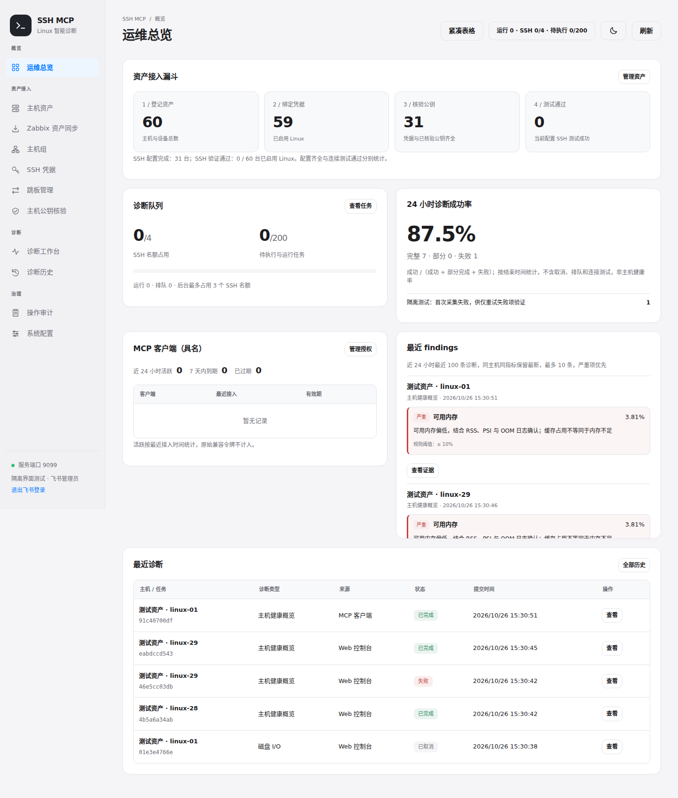

# SSH MCP Server · Linux 智能诊断 MCP 服务器

> 独立部署、中文优先、免 Agent 的 Linux SSH 诊断服务。默认 Web/MCP 端口 **9099**。

**当前版本：v0.4.0（待真实环境联调）**

从 Zabbix MCP 分批发现 Linux 资产，保留 Host ID 与主机组；通过页面预览登记、绑定凭据、公钥核验与 SSH 测试完成接入。提供 32 类单项只读诊断、6 个固定组合场景、42 个 MCP 工具、后台批量任务与客户端范围授权。



## 项目定位

本项目独立于 Zabbix MCP 和 AI Ops Platform 运行，拥有自己的主机资产、SSH 凭据、连接测试、密钥核验、诊断执行、审计记录和 Streamable HTTP MCP 服务。AI 客户端只需要连接 MCP 服务，不需要获得 SSH 私钥。

- **Web 管理**：`http://127.0.0.1:9099/`
- **MCP 地址**：`http://127.0.0.1:9099/mcp`
- **健康检查**：`GET /healthz`

## 安全设计

- 首次初始化 Token 用于绑定飞书应用和指定管理员 Open ID；完成后 Web 只能通过飞书 OAuth 登录，MCP 独立使用 Bearer Token。
- Web/API 使用飞书管理员会话、HttpOnly Cookie 与 CSRF 校验；MCP 使用独立客户端令牌，支持主机组、动作范围、到期与撤销。
- SSH **只允许已登记的内网 IP**、已登记 SSH 凭据、经管理员确认的主机公钥。
- 严格 SSH 主机公钥校验，批量获取只能产生候选结果，不自动信任。
- 固定只读诊断动作，MCP 仅开放服务端白名单；SSH 凭据支持上传私钥文件，私钥验证后加密保存。
- SSH 私钥、诊断请求及结果加密保存；新客户端令牌只显示一次，数据库仅保存哈希。
- `root` 可以使用标准诊断模式，但 **root 本身并非只读账户**。固定命令不能保证操作系统层面绝对只读。
- 默认只绑定回环地址。公网使用须额外配置 HTTPS、访问控制、可信代理和来源 IP 限制；不要直接暴露 HTTP。
- 当前没有自动导入旧平台数据库/凭据。迁移时不复制旧平台的加密密钥或明文私钥文件；使用 Web 重新登记。

## 快速启动（Docker Compose）

```bash
git clone https://github.com/beijing10000-boop/ssh-mcp-server.git
cd ssh-mcp-server
docker compose up -d --build
docker compose ps
docker compose logs --tail=50 ssh-mcp
```

查看一次性初始化 Token：

```bash
docker compose exec ssh-mcp cat /app/data/bootstrap.token
```

完成飞书初始化后，在 Web「系统配置 → MCP 接入」为 AI 平台签发专用令牌。原始 `/app/data/mcp.token` 继续兼容旧客户端；迁移完成后可在 Web 停用。不要将令牌发到聊天窗口、工单、公开日志或 GitHub。

需开放给可信内网时，在项目目录创建 `.env`，并设置 `WEB_BIND_IP=内网绑定IP`；建议同时通过防火墙限制允许访问的源地址。

本次升级见 [v0.4 发布与迁移说明](docs/RELEASE-v0.4.md)。配置入口见 [v0.3.1 系统配置说明](docs/RELEASE-v0.3.1.md)。请先阅读 [v0.3 优化与升级说明](docs/RELEASE-v0.3.md)，以及 [安装部署](docs/INSTALLATION.md)、[v0.2 升级与验证](docs/RELEASE-v0.2.md)、[架构评估](docs/ARCHITECTURE.md)、[AI 平台改造方案](docs/AI-PLATFORM-INTEGRATION.md)、[MCP 接入](docs/MCP.md)、[安全说明](docs/SECURITY.md)、[目录与 IP 流量分析](docs/INSIGHTS.md)。

## 核心能力

| 能力 | 说明 |
| --- | --- |
| 系统配置 | Zabbix MCP 连接、SSH MCP 客户端授权、飞书登录与历史保留策略集中管理 |
| 中文 Web | 深浅主题、四组导航/本地 SVG、紧凑表格、手机历史卡片、筛选 URL、准备情况抽屉 |
| 批量管理 | 最多 1000 台表格粘贴/API 原子导入、批量启停、按筛选选择；失败整批回滚 |
| Zabbix 资产同步 | MCP 连接验证、Linux 筛选、精简 ID 索引、自适应详情拆批、原始分组和 Host ID 关联、登记预览 |
| SSH 凭据 | 上传 OpenSSH/PEM 私钥文件或粘贴内容，支持私钥口令与轮换，验证后加密保存 |
| 接入验证 | 批量绑定 SSH 凭据、账号和跳板；公钥核验后批量测试，清楚显示逐台准备状态 |
| 主机公钥获取 | 支持批量探测、逐行预检与匹配项确认，确认时再次检查目标，绝不自动信任 |
| SSH 诊断 | 32 类固定单项 + 6 个组合场景；结构化 summary/findings，磁盘/内存/负载阈值与证据展示 |
| 诊断任务 | 显式搜索目标、逐台接受/跳过、批次进度、仅重试失败项；4 名额中预留 1 个给同步调用 |
| 目录空间排行 | 对 /data、/var 等安全路径执行限时一层 du，占用空间从大到小排序 |
| IP 连接数排行 | 从 ss 统计当前远端 IP 的 TCP 连接总数和已建立数量 |
| IP 流量采样 | 使用 ss -ti 的 TCP 字节计数做约 3 秒同连接增量排名（有明确覆盖限制） |
| MCP 工具 | 42 个工具；批量 Host ID 解析、按组搜索、默认摘要、独立 triage 授权、批次分页查询 |
| 访问控制 | 每客户端限定主机组和诊断动作、有效期 1–365 天、独立撤销；旧全局令牌可停用 |
| 部署 | 单容器 + SQLite，独立端口 9099，日志轮转 |

## 与现有 AI Ops Platform 关系

拆分合理：Zabbix MCP 提供监控证据，SSH MCP 提供实时诊断，AI 平台负责编排与报告。AI 平台需要增加第二个 MCP 会话，不能直接替换现有 Zabbix MCP URL。已提供 [可运行适配器示例](examples/ai_platform_adapter.py) 和 [逐文件改造方案](docs/AI-PLATFORM-INTEGRATION.md)。本仓库的更新不会自动切换现有 AI 平台。

## 验证与运行边界

包含接口/权限回归、真实本机 SSH 协议测试、三种桌面宽度及 390/768px 窄屏的浏览器检查、MCP SDK 联调以及容器启动/持久化 CI。截图及浏览器诊断输出均来自隔离测试数据。

当前采用单进程 + SQLite，不支持多副本执行。服务重启会将未完成任务标记为失败，需人工重试。真实飞书租户、Rocky Linux、跳板及生产主机仍需部署方联调验收。
