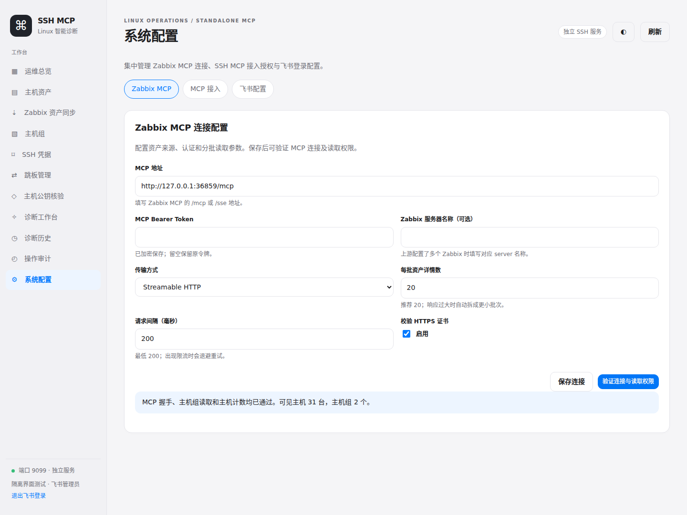
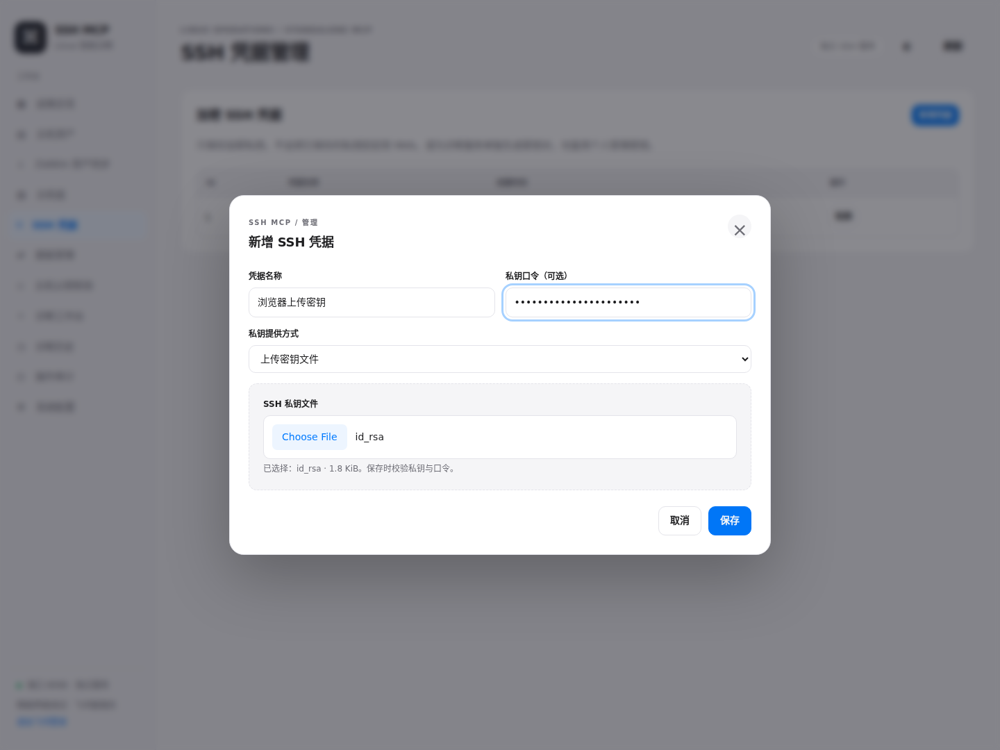

# v0.3.1 · 系统配置与密钥文件上传

左侧原「飞书管理」和「MCP 接入」合并为 **系统配置**，包含三个页签：

| 页签 | 内容 |
| --- | --- |
| Zabbix MCP | MCP 地址、认证令牌、服务器名称、HTTP/SSE、证书校验、分批大小与请求间隔；保存和验证连接 |
| MCP 接入 | SSH MCP 客户端令牌、主机组/动作授权、有效期、撤销和原始令牌开关 |
| 飞书配置 | 飞书应用与回调信息、Secret 配置状态、管理员 Open ID 名单 |

「Zabbix 资产同步」保留资产来源摘要、主机组选择、资产筛选、发现进度、预览和登记。在来源卡片点击 **系统配置**，可直接进入 Zabbix MCP 页签；保存并验证后返回资产同步页面即可继续操作。同步页面不再包含连接参数编辑表单。

原 `#clients` 和 `#feishu` 链接会自动跳转到系统配置的对应页签。原有凭据、令牌、飞书绑定和后端接口继续使用，升级无需重新填写。



## 上传 SSH 私钥文件

在「SSH 凭据 → 新增凭据」填写名称，选择默认的 **上传密钥文件**，然后选择本机私钥文件并保存。轮换凭据同样支持上传。

- 支持 OpenSSH / PEM 私钥，包括 `id_ed25519`、`id_rsa` 等无后缀文件和 `.pem`、`.key`；最大 16 KB（16000 字节）。
- 加密私钥填写对应口令，保存时由服务端验证。格式或口令错误不保存、不覆盖旧凭据。
- `.pub` 是公钥，不能作为登录凭据；PuTTY `.ppk` 需要先导出为 OpenSSH 私钥。
- 也可切换为 **粘贴私钥内容**，沿用原输入方式。
- 浏览器读取所选文件内容后，通过已有凭据接口提交；服务端验证并加密保存，不保留原始上传文件。弹窗关闭后清空文件选择和输入内容。



## 升级

完成数据备份后，在原项目目录更新并重建：

```bash
cd /data/ssh-mcp-server
git fetch origin
git switch main
git pull --ff-only origin main
docker compose up -d --build
docker compose ps
```

健康接口版本为 `0.3.1`。浏览器按 **Ctrl + F5** 后，从左侧「系统配置」进入。保留原数据卷，不执行 `docker compose down -v`。
