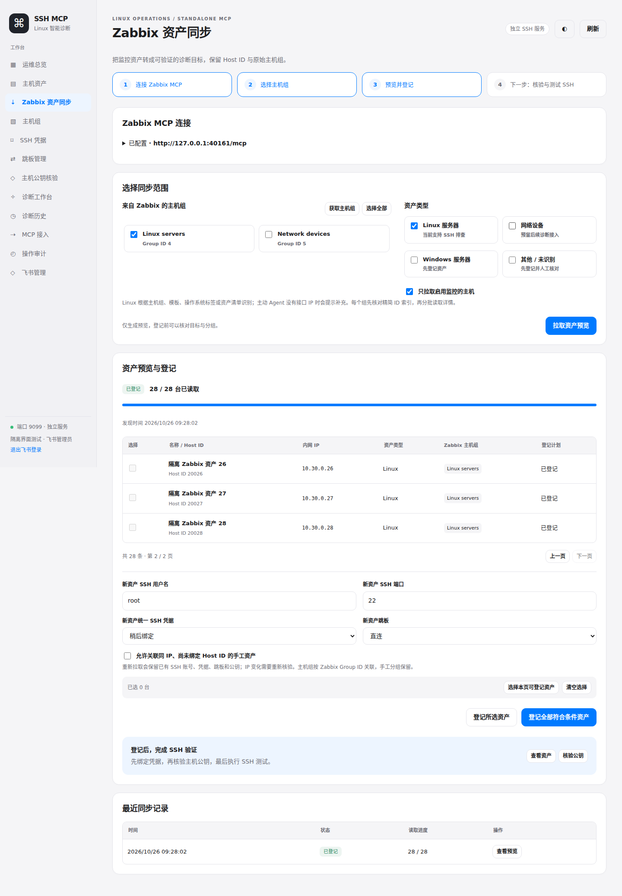

# v0.3.0 · Zabbix 资产同步与运维诊断扩展

本次更新把资产发现、登记与 SSH 验证连成一个可操作流程，并将固定诊断从 20 类扩展到 32 类。MCP 提供 39 个工具，包括后台批量诊断、任务查询、取消和按授权范围查看目录。

## 1. 从 Zabbix MCP 登记资产

在左侧打开 **Zabbix 资产同步**，按以下步骤操作，无需编辑配置文件或 JSON：

1. 填写 Zabbix MCP 地址（例如 `http://Zabbix-MCP-IP:8080/mcp`）、MCP Bearer Token；多 Zabbix 上游可指定 server 名称。支持 Streamable HTTP 与 SSE；HTTPS 默认校验证书。
2. 点击 **验证连接与读取权限**。验证包含 MCP 初始化、工具发现、主机组读取与主机计数；必须向此令牌开放 `host_get` 和 `hostgroup_get`，只读权限即可。
3. 勾选来自 Zabbix 的主机组。默认只勾选 Linux 资产类型；也可登记网络设备、Windows 和其他类型，后面三类暂不开放 Linux SSH 诊断。
4. 点击 **拉取资产预览**。后台按所选组去重 Host ID，显示进度；可以离开页面，通过最近同步记录返回。
5. 在预览核对名称、Host ID、内网 IP、类型、原始主机组和登记计划。新主机可统一选择凭据、账号、SSH 端口与跳板；每次最多登记 1000 台。
6. 点击 **登记所选资产** 或 **登记全部符合条件资产**。相同预览重复登记不会重复创建；失败行会列出原因。超过 1000 台时继续登记剩余资产。
7. 在 **主机资产** 勾选导入主机，必要时点击 **绑定 SSH**。然后 **获取公钥 → 独立核对指纹 → 确认公钥 → 测试 SSH**。批量测试每次最多 100 台，可在诊断历史查看逐台结果。

**登记成功只表示资产资料已保存。** 资产页明确显示待绑定凭据、待核验公钥、待测试、失败、SSH 验证通过与仅登记资产。连接测试会检查远端返回的固定标识、数字 UID 和 Linux 类型。系统不会在资产导入时自动信任公钥。



### 拉取限制如何处理

Zabbix `host.get` 没有普通 offset 分页，不能重复查询 `limit=20` 后假装获得不同页面。本实现采用两阶段读取：

- 每个所选主机组先查询数量，再只读取 `hostid` 精简索引；数量与唯一 ID 数量必须一致。单组索引上限 1000 项，本次发现总上限 10000 项；组数量同样最多 1000。
- 按索引每次读取 1–100 台详情，默认 20 台；每次请求间隔默认 400 ms，最低 200 ms。
- 详情响应被截断或缺项时，将该批二分递归重试，直到单台；单台仍不完整则停止，任务标记失败。
- 支持 initMAX 的文本安全声明、JSON 包装和列表末尾 `_truncated` 元数据。限流/HTTP 读超时最多尝试 3 次，按 1、2 秒退避；持续失败明确返回错误。
- 索引本身被截断、计数不一致、单组超过 1000 或单台详情超限时，**不会登记不完整预览**。请在 Zabbix 细分主机组，或在 Zabbix MCP 管理端提高响应字符上限后重新发现；调小详情批次不能解决索引上限。
- 仅支持一个 Zabbix 来源绑定；存在 Host ID 映射后拒绝切换来源，避免不同系统里同名 Host ID 错绑。

Linux 根据主机组、父模板名称、OS 标签或资产清单 OS 识别，不根据 IP、主机名称或“存在 Agent”直接推测。未知 OS 默认跳过。主动 Agent 没有接口 IP、仅 DNS 接口、公网 IP、主机组缺失等情况会提示补充资料；不会把 Agent 的 10050 或 SNMP 的 161 当作 SSH 端口。

### 已有资产与分组

- Host ID 精确匹配优先；IP 与其他 Host ID 冲突会拒绝登记该行。同 IP 的手工资产需要明确勾选允许关联。
- 重新发现只更新名称、IP、类型和 Zabbix 分组；已登记的 SSH 账号、凭据、端口、跳板、启停选择保留。
- IP 改变会清除主机公钥候选与已核验公钥，重置测试状态，增加资产版本，要求重新核验。
- 预览后资产被其他操作修改时拒绝覆盖；预览超过 30 分钟要求重新发现。
- 保存远端 Group ID 与本地组 ID 的对应关系；Zabbix 组改名保持本地 ID。与手工组重名时建立带 Zabbix 标识的新组，避免扩大已有组授权。
- 同步只管理自身创建的分组成员关系，保留手工分组。资产从上游删除或移出本次范围时，不自动删除本地资产；管理员可筛选、核对并停用。
- MCP 连接配置、令牌和资产预览以密文保存；令牌不回显。发现任务的筛选选项只记录分组 ID 与资产类型。任务重启中断时标为失败，不能把残留预览登记为完整资产。

## 2. 扩充只读运维诊断

| 场景 | 新增能力 | 覆盖限制 |
| --- | --- | --- |
| 性能 | CPU/内存/I/O PSI 压力 | 需要内核开启 PSI；旧内核显示能力缺失 |
| 资源 | 系统文件句柄、PID、当前 SSH shell 的资源限制 | shell 的 ulimit 不是业务进程限制 |
| 存储 | 块设备结构、挂载类型、只读文件系统 | 不修改分区或挂载，不输出可能含密码的挂载选项 |
| 时间 | UTC、时区、NTP 同步、chrony tracking | 需要 systemd，chronyc 为可选项 |
| 网络 | TCP 状态分布 | 当前 TCP 快照，不是历史趋势或所有协议流量 |
| 服务 | 系统服务清单、systemd timer 上次和下次运行 | 有行数限制，不读取完整 cron 脚本 |
| 日志 | 系统 warning/error 日志、OOM 线索 | 1–120 分钟；有限行数，不匹配不代表从未发生 |
| 容器 | Docker/Podman CPU、内存、网络、块 I/O | 单次限时 stats，不读取环境变量或进入容器 |
| 安全 | SELinux、AppArmor、防火墙服务状态 | 不是完整防火墙规则或合规审计 |

新增 12 个诊断工具沿用固定命令、超时、输出限额、脱敏、加密历史、主机组/动作授权。新动作需要新建客户端并选择相应动作，签发新令牌后更新 AI 平台；已有窄权限令牌不会自动扩大权限。新增动作只适用于标准 SSH 模式，受限强制命令网关会在提交前明确拒绝。

新增 `ssh_submit_diagnostics`、`ssh_get_diagnostic_job`、`ssh_cancel_diagnostic_job` 支持后台批量排查；批量提交逐台检查权限，后台开始前再次检查客户端有效期、撤销状态、主机组和动作范围。客户端只能查询或取消自己提交、且仍获授权的任务。已运行的 SSH 不承诺在令牌撤销瞬间中止。

另有 `ssh_list_tool_catalog` 与 `ssh_list_groups`，只返回该客户端授权的动作和分组。完整工具表见 [MCP 接入文档](MCP.md)。AI 平台适配器示例同步支持新增诊断动作。

### 官方参考与本项目实现选择

以下是能力设计参考；本项目通过 SSH 读取本地主机，没有接入这些云厂商的控制面 API。

| 官方项目/文档 | 参考能力 | 本次落地 |
| --- | --- | --- |
| [阿里云 CloudOps MCP](https://github.com/aliyun/alibaba-cloud-ops-mcp-server) | 资源查询、指标采集、运维工具编排 | Zabbix 资源关联、分类诊断、后台批量执行 |
| [微软 Azure Monitor MCP](https://learn.microsoft.com/en-us/azure/developer/azure-mcp-server/tools/azure-monitor) | 日志、性能与资源健康查询 | 系统告警日志、健康快照、压力与时间同步 |
| [腾讯云 CLS MCP](https://github.com/Tencent/cls-mcp-server) | 日志查询、响应长度与工具调用约束 | 有限时间/行数日志、响应完整性检查、脱敏 |
| [腾讯云 TAT MCP](https://github.com/TencentCloudCommunity/mcp-server) | 批量运维与执行结果查看 | 白名单诊断任务的批量提交、查询与取消 |
| [Zabbix host.get](https://www.zabbix.com/documentation/7.4/en/manual/api/reference/host/get)、[initMAX Zabbix MCP](https://github.com/initMAX/zabbix-mcp-server) | 原生查询参数、选择字段、响应限制 | 精简 ID 索引与自适应详情分批 |

## 3. 页面与交互

- 新增四步同步引导、连接验证、分组选择、进度、登记计划、冲突原因和后续验证入口。
- 批量导入可从 Excel 复制两列/三列内容直接粘贴：主机名、内网 IP、可选 Host ID，无需写 JSON；原 JSON API 保留兼容性。
- 资产支持批量绑定账号/凭据/跳板、批量连接测试及明确准备状态；主机组直接显示在表格。
- 诊断工具按连接与概览、性能与进程、存储、网络、服务与日志、系统与容器分类；点击能力卡可选中对应动作，只显示该动作需要的输入。
- 运行中的同步禁用连接与范围编辑，避免轮询刷新丢失编辑内容。

## 升级与回退

合并本次改动后，在现有项目目录更新并重建：

```bash
git switch main
git pull --ff-only origin main
docker compose up -d --build
docker compose ps
curl -fsS http://127.0.0.1:9099/healthz
```

健康接口应返回 `version: 0.3.0`。保持原有数据卷和 `master.key`；数据库自动追加资产类型与同步表，旧资产默认 Linux，既有令牌、SSH 凭据和主机公钥保留。不要执行 `docker compose down -v`。

升级前应备份整个数据卷（数据库与 master.key 必须成套保留）。若回退旧程序，恢复对应备份；v0.2 不识别新资产类型，直接用 v0.2 打开包含非 Linux 资产的新数据库不受支持。

## 验证范围

接口/权限测试、真实回环 SSH 协议测试与桌面流程均使用隔离数据。浏览器测试使用真实 MCP SDK 连接本机模拟的 Zabbix MCP，模拟 initMAX 安全声明与响应截断，验证自动拆批、只拉 Linux、登记前不写资产、公钥未自动信任、分页与诊断分类。桌面测试涵盖 1280、1440、1920 宽度，截图为隔离数据。

当前工作环境没有 Docker，容器构建/持久化交由仓库 CI。真实 Zabbix 7.4/8.0、飞书 OAuth、Rocky 系统工具与生产 SSH 网络尚需部署方联调；可在页面逐项测试。目标服务器不需要新增 Agent 或 Python，按动作使用系统现有命令，缺失命令会报告能力缺口。
